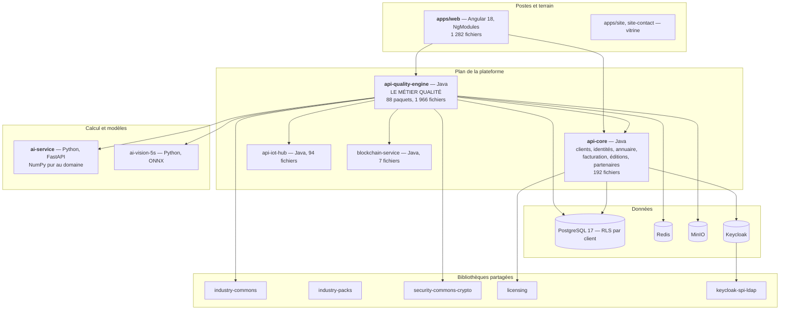
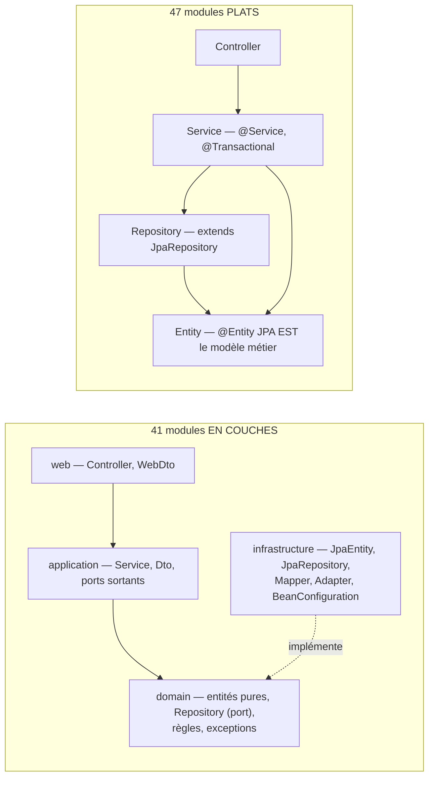
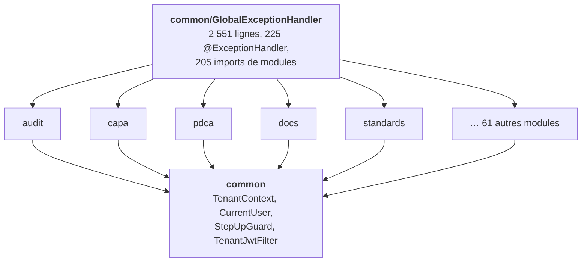
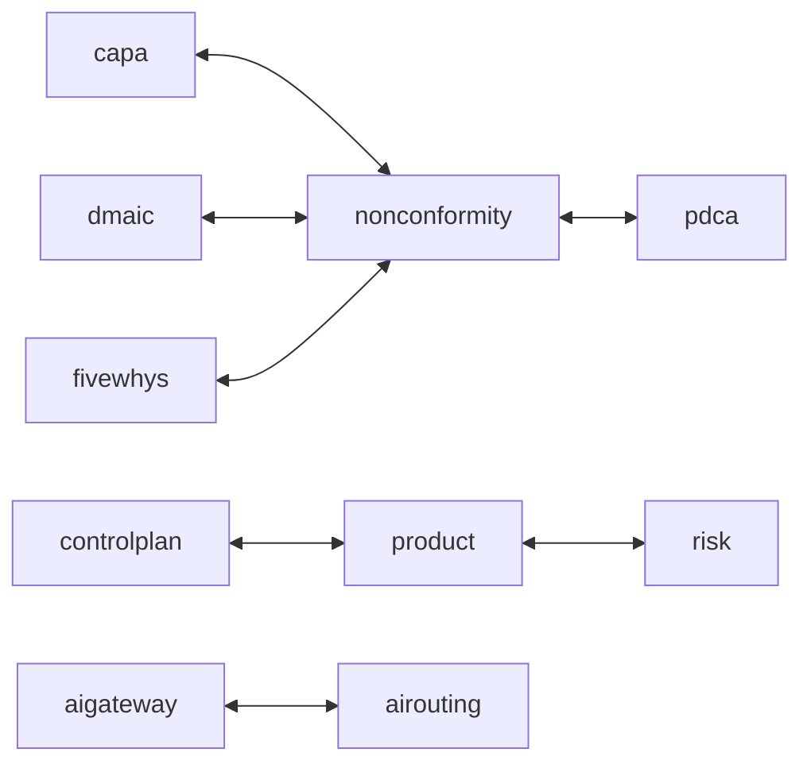
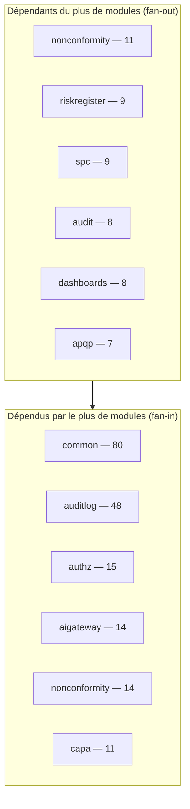
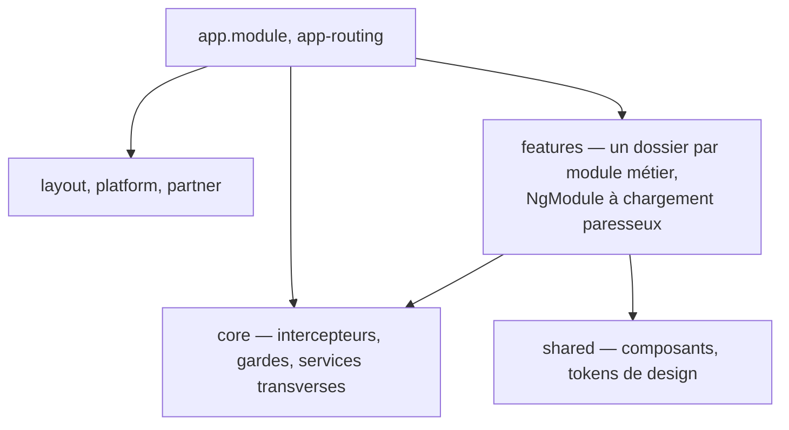

# Architecture — état des lieux mesuré

> Ce document décrit l'architecture **telle qu'elle est**, mesurée sur le dépôt, et non telle
> qu'elle est visée. L'architecture visée se lit dans [`CLAUDE.md`](../../CLAUDE.md) et dans
> [les vues C4](../wiki/technique/architecture.md) ; les écarts entre les deux sont la matière
> de ce document.
>
> Tous les chiffres ci-dessous sont comptés, pas estimés, et datent du **18 novembre 2026**.
> Ils vieilliront : la façon de les recompter est donnée en annexe, pour qu'un relevé ultérieur
> soit comparable plutôt que refait.
>
> Ce relevé a servi de base à un premier alignement, décidé par l'[ADR 0128](../adr/0128-l-architecture-tient-par-le-build-et-non-par-la-memoire.md).
> Les sections ci-dessous donnent **l'état après** cet alignement, et nomment ce qui était
> là avant quand c'est ce qui explique la décision. Ce qui reste à faire est en §8.

---

## 1. Les applications et ce qui les sépare

Le découpage entre applications est net et il tient : **le métier de la qualité est dans un
seul déploiement**, `api-quality-engine`, et c'est un choix assumé (modulith). Les frontières
problématiques ne sont pas entre les applications ; elles sont **à l'intérieur** de celle-ci.

---

## 2. Dans le moteur qualité : deux architectures cohabitent

C'est le fait central de ce relevé. Sur les 88 paquets métier, **deux styles coexistent**, et
la ligne de partage est chronologique : les modules écrits tôt sont plats, ceux écrits
récemment sont en couches.

**Ce que contient chaque camp**, par ordre d'importance métier :

| | Modules |
| --- | --- |
| **Plats** (47) | `pdca` `fives` `dmaic` `circle` `ishikawa` `fivewhys` — *les cinq méthodes* ; `nonconformity` `capa` `complaints` `supplier` — *écarts et actions* ; `standards` `audit` `docs` `training` `change` `risk` `spc` `calibration` `apqp` ; `kpi` `settings` `config` `common` `auditlog` `crypto` `rls` `edition` `webhooks` `workflow` ; `aigateway` `industry` `iot` et les connecteurs (`itsm`, `erpconnector`, `ehrconnector`, `commconnector`) |
| **En couches** (41) | `product` `controlplan` `riskregister` `stakeholders` `revisionrequests` `smi` `ims` `ideas` ; `dashboards` `marketplace` `notifications` `tenantmodules` `apikeys` `authz` `ratelimit` `circuit` `blockchain` ; toute la gouvernance réglementaire : `gdpr` `ropa` `consent` `dpia` `retention` `breach` `privacynotices` `processoragreements` `crossbordertransfers` `dpoappointments` `nis2measures` `cyberincidents` ; toute la famille IA : `aiact` `aiactfria` `aiconformity` `aieudb` `aiincidents` `aipmm` `aiqms` `airouting` `automateddecisions` ; plus `academy` `ehs` `costofquality` |

**Le cœur du produit est dans le camp plat.** Les cinq méthodes qui donnent son nom à la
plateforme, les écarts, les CAPA, le Standards Hub : tout cela est écrit sans couches. Les
modules exemplaires, eux, sont les plus périphériques et les plus récents.

Mesure de l'écart :

| Mesure | Valeur |
| --- | --- |
| Entités JPA au total | 182 |
| …dont **hors** d'une couche `infrastructure` | **113** (62 %) |
| Ports (interfaces) déclarés dans un `domain` | 59 |
| Services annotés `@Service` directement | 80 |
| Fichiers à injection par champ (`@Autowired`) | 11 |

Les 113 entités hors infrastructure sont la mesure directe du couplage domaine/persistance :
dans ces modules, l'objet que JPA charge **est** l'objet qui porte les règles.

---

## 3. L'inversion de dépendance du socle

`common` est le paquet le plus dépendu du moteur : **80 modules en dépendent**. Et il dépendait
lui-même de **66 modules**, à cause d'un seul fichier : `GlobalExceptionHandler` devait importer
l'exception de chaque module pour savoir quel statut HTTP lui répondre.

Conséquences, mesurées avant l'alignement :

- **65 des 72 cycles entre modules** du moteur n'existaient que par ce fichier.
- Tout module neuf devait **modifier un fichier partagé** pour que ses refus sortent avec le bon
  statut : le socle n'était pas extensible sans être édité.
- 225 gestionnaires pour 225 exceptions, tous **les six mêmes lignes**, à trois valeurs près
  (le statut, le fragment d'URL, le titre).

**Depuis l'ADR 0128, chaque module dit ses propres refus**, dans son propre
`@RestControllerAdvice` ordonné devant le filet du socle. Le fichier passe de 2 551 à 335
lignes et de 205 imports de modules à **zéro** ; la forme du refus est écrite une fois, dans
`common/ProblemDetails`. Une règle ArchUnit tient désormais l'invariant, parce que c'est la
règle la plus facile à casser sans y penser — il suffit d'ajouter un gestionnaire « pour aller
plus vite ».

Il reste **7 cycles**, et ce sont de vrais couplages réciproques entre modules métier :

Cinq des sept passent par `nonconformity`, et cela se comprend : un écart ouvre un dossier
CAPA, un dossier CAPA renvoie à son écart ; un projet DMAIC naît d'un écart et l'écart cite le
projet. Ce sont des allers-retours du métier, pas des accidents. Les rompre demande un port de
chaque côté — un chantier par paire, et une décision à prendre paire par paire.

---

## 4. Les pôles de dépendance

`nonconformity` est à la fois très dépendu (14) et très dépendant (11) : c'est le carrefour du
métier, et c'est aussi là que le couplage coûte le plus cher. 251 arêtes distinctes entre
modules, pour 508 dépendances de fichier à module — contre **315 arêtes** avant l'alignement,
le socle n'étant plus relié à tout.

`common` monte de 78 à 80 modules dépendants, et c'est l'effet voulu : les modules connaissent
désormais `ProblemDetails`, alors qu'avant c'était le socle qui les connaissait. Le nombre
grandit, le **sens** est le bon.

---

## 5. Ce qui garde l'architecture, et ce qui ne la garde pas

Trois tests ArchUnit existent (`api-quality-engine`, `api-iot-hub`, `industry-commons`), plus
un test dédié à l'IMS. Celui du moteur qualité, `HexagonalArchitectureTest`, énonce 22 règles.

**Ces règles étaient une liste blanche tenue à la main.** Chaque règle nommait un paquet
précis, et il n'en existait aucune portant sur `..domain..` en général :

| | Avant | Après |
| --- | --- | --- |
| Paquets `domain` dans le moteur | 54 | 54 |
| …tenus par une règle | **11** (20 %) | **54** (100 %) |
| …par une règle nommée, plus stricte | 11 | 11 |

L'ADR 0128 ajoute quatre règles **universelles** — le domaine sans cadre technique, le domaine
qui ne regarde pas vers l'extérieur, l'application qui ne connaît que ses ports, le socle qui
ne dépend d'aucun module — et conserve les onze règles nommées, qui sont *plus strictes* (elles
interdisent en plus PDFBox dans l'instantané 8D, ZXing dans l'export, un module voisin pour le
8D et les parties intéressées). La portée des règles est le code de **production** : un banc
assemble légitimement un adaptateur réel, et peut emprunter le contrôleur d'un autre module
pour éprouver un filtre transverse.

Avec une liste blanche, un module qui oubliait d'ajouter ses deux règles n'était jamais
vérifié. La discipline tenait quand même sur presque tout — mais par la mémoire des
développeurs, pas par le `build`. Et elle tenait **moins bien que les imports ne le laissaient
croire** : vingt-deux services applicatifs portaient
`@org.springframework.beans.factory.annotation.Autowired` écrit en **nom pleinement qualifié
dans le corps**, invisible à toute mesure qui ne lit que les imports. ArchUnit, qui lit le
bytecode, les voyait tous.

Ces vingt-deux annotations ne servaient à rien : la configuration de chaque module construit
déjà son service d'un `new` explicite, donc Spring n'autocâblait aucun de ces constructeurs.
Elles ont été retirées, chacune avec cette preuve. Et `GetCoverageMatrixUseCase` (IMS) a perdu
son `@Service` au profit d'une déclaration dans `ImsConfig`, comme le module le faisait déjà
pour son service de domaine.

Restent **deux dérogations**, nommées dans la règle avec leur raison :

| Module | Fichiers | Nature |
| --- | --- | --- |
| `academy` | 16 | Les 9 entités du domaine **sont** des entités JPA, et ses services applicatifs sont annotés Spring. Ce module porte les noms de couches sans en respecter la règle : le remettre d'aplomb demande de séparer entités de persistance, entités de domaine et convertisseurs. |
| `marketplace` | 1 | `ManifestScanner` lit un manifeste avec Jackson. C'est un analyseur de fichier : sa place est en infrastructure, derrière un port. |

Une exception est **raisonnée** et non tolérée : `org.springframework.transaction.annotation`
est admis dans `application`, et nulle part ailleurs. Décider qu'une opération doit être
atteinte ou défaite entièrement est une décision du cas d'usage — `ApiKeyService.rotate` le dit
en toutes lettres : émettre une clé peut échouer après avoir révoqué l'ancienne, et laisser le
client sans aucune clé valide. Pousser cette frontière dans l'adaptateur la retirerait à celui
qui sait où elle doit tomber. Ce qui reste interdit, c'est que le **domaine** la connaisse.

Par ailleurs, **Spring Modulith**, que `CLAUDE.md` §10.2 inscrit dans la pile imposée,
n'apparaît dans aucun `pom.xml`. Le moteur est un modulith par convention de nommage, sans
l'outil qui en vérifierait les frontières.

---

## 6. Le front

Le front est cohérent : NgModules, chargement paresseux par fonctionnalité, pas de composant
*standalone* (ADR 0002), HTML et SCSS en fichiers séparés. Chaque fonctionnalité porte son
service d'accès HTTP et ses types. C'est la partie du dépôt où l'écart entre l'intention et la
réalité est le plus faible.

---

## 7. Ce qui reste, et dans quel ordre

L'alignement de l'[ADR 0128](../adr/0128-l-architecture-tient-par-le-build-et-non-par-la-memoire.md)
a traité ce qui bloquait tout le reste : la dépendance du socle vers les modules, et l'absence
de garde. Les chantiers suivants sont nommés ici parce qu'un chantier qu'on ne nomme pas
n'existe pas — et classés par ce qu'ils rapportent, non par leur taille.

| # | Chantier | Pourquoi d'abord, ou pas | Ampleur |
| --- | --- | --- | --- |
| 1 | **Les 47 modules plats** — `pdca`, `fives`, `dmaic`, `circle`, `ishikawa`, `nonconformity`, `capa`, `standards`, `audit`, `docs`… | C'est le cœur du produit, et c'est là que l'entité JPA porte les règles : 113 entités sur 182 sont hors d'une couche `infrastructure`. Aucune règle de maçonnerie ne les y forcera ; il faut, module par module, séparer entité de persistance, entité de domaine et convertisseur. À prendre **un module à la fois**, en commençant par celui qu'on touche le plus. | ~10 à 25 fichiers par module |
| 2 | **`academy`** | Seul module qui porte les noms de couches sans en respecter la règle. Il est donc trompeur pour qui le lit, plus que simplement en retard. | ~25 fichiers |
| 3 | **`marketplace/ManifestScanner`** | Un analyseur de fichier dans la couche applicative. Le port existe déjà à côté : c'est le plus petit gain de la liste, et le plus rapide. | ~3 fichiers |
| 4 | **Les 7 cycles entre modules** | Cinq passent par `nonconformity`, et traduisent de vrais allers-retours du métier. Les rompre demande un port de chaque côté, et c'est une décision à prendre **paire par paire** : toutes ne méritent pas d'être rompues. | 1 décision + ~6 fichiers par paire |
| 5 | **`api-core`** — même défaut qu'avait le moteur : `GlobalExceptionHandler` de 435 lignes, 28 gestionnaires, 11 imports de modules, et **aucune règle d'architecture** dans cette application | Le défaut est identique mais huit fois plus petit. Le découpage y a été tenté : les corps de ses gestionnaires ont d'autres formes, la table du contrat ne concordait pas avant/après, et le travail a été défait plutôt que livré non vérifié. | ~12 fichiers |
| 6 | **Spring Modulith** | `CLAUDE.md` §10.2 l'inscrit dans la pile imposée, il n'est dans aucun `pom.xml`. Soit on l'ajoute et il vérifie les frontières de modules que les règles ArchUnit ne couvrent pas encore, soit on retire la ligne de la spécification. Laisser l'écart, c'est laisser la spécification mentir. | 1 ADR |

Les deux premiers points sont du même ordre : **le cœur du produit est dans le camp plat**, et
aucune règle automatique ne l'en sortira. Ce qui est acquis, en revanche, est qu'un module
**neuf** ne peut plus y entrer sans que le `build` le dise.

---

## 8. Annexe — recompter

Les chiffres de ce document se recalculent depuis la racine du dépôt :

| Mesure | Commande |
| --- | --- |
| Modules plats / en couches, entités, ports, pureté | `python scripts/arch/releve.py` |
| Couverture des règles ArchUnit | `python scripts/arch/releve.py --archunit` |
| Graphe des dépendances et cycles | `python scripts/arch/releve.py --graphe` |
